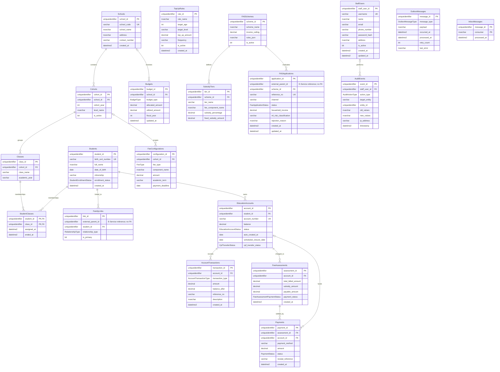

# Admin Portal database (`AdminPortalDb`)

Nguồn: migration `20261012092800_InitialCreate` của `AdminPortal.Infrastructure`.

Admin Portal sở hữu dữ liệu quản trị, trường/lớp/học sinh, tài khoản giáo dục gốc, cấu hình phí, ngân sách, FAS và RBAC. `external_parent_id` là tham chiếu logic sang E-Service, không phải foreign key xuyên database. Admin Portal không lưu Singpass/MyInfo.

## Ranh giới dữ liệu

- Không có bảng `ParentAccounts`, Singpass, MyInfo, chatbot hay hồ sơ phụ huynh.
- `FamilyLinks.external_parent_id` và `FASApplications.external_parent_id` chỉ là ID tích hợp; đồng bộ qua API/event + outbox/inbox.
- `TopUpRules`, `Budgets` và cấu hình phí chỉ thuộc Admin Portal.
- Không còn các bảng role/permission/role-assignment hoặc cột staff type; access matrix sẽ được thực thi bằng claims/policies bên ngoài schema này.
