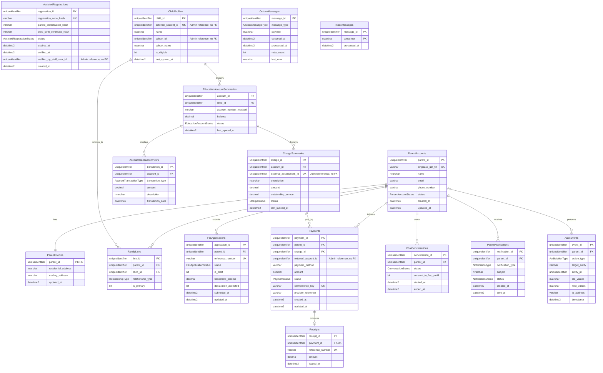

# E-Service Portal database (`EServicePortalDb`)

Nguồn: migration `20261012092801_InitialCreate` của `EServicePortal.Infrastructure`.

E-Service Portal sở hữu danh tính phụ huynh, Singpass, hồ sơ gia đình, đăng ký hỗ trợ, FAS phía người dân, thanh toán và các read model được đồng bộ từ Admin Portal. Các cột bắt đầu bằng `external_` không tạo foreign key sang Admin database.

## Ranh giới dữ liệu

- Singpass và hồ sơ phụ huynh chỉ tồn tại trong E-Service Portal.
- `ChildProfiles`, `EducationAccountSummaries`, `AccountTransactionViews` và `ChargeSummaries` là read model cục bộ, không truy vấn trực tiếp Admin database.
- `verified_by_staff_user_id`, `external_student_id`, `school_id`, `external_assessment_id` và `external_account_id` chỉ là ID tích hợp; không có foreign key xuyên database.
- E-Service Portal không chứa RBAC nhân viên, ngân sách, quy tắc top-up hay cấu hình phí quản trị.
